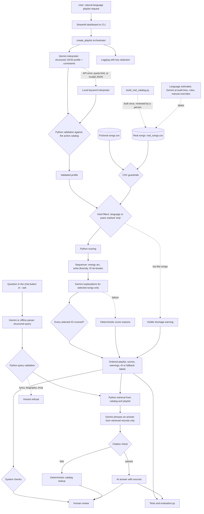

# VibeMatch AI: Context-Aware Playlist Generator

VibeMatch AI turns a sentence like *"I am working out, I want 15 songs all in Spanish, kinda recent"* into an ordered, explained playlist from a verified song catalog, and then answers questions about those songs. Gemini reads the request and phrases explanations and answers. Python validates everything Gemini returns and does all of the selecting, scoring and ordering. Gemini can never invent a song, an ID, a score or a fact.

**Why it matters:** language models are good at understanding what people mean, but unreliable as a source of facts. This project shows one way to combine the two safely. The model interprets; deterministic code decides and checks, and every AI step has a tested fallback. The app is fully usable without an API key.

- **Code:** https://github.com/gimenezdiego002/VibeMatch-AI
- **Run it:** `streamlit run streamlit_app.py` (dashboard) or `python -m src.main` (CLI)
- **Responsible-AI write-up:** [`model_card.md`](model_card.md)
- **Walkthrough video (optional):** _Student placeholder: add your Loom link here if you record one._

## Base project (Module 3)

This project extends my **Music Recommender Simulation** from CodePath AI110 Module 3. That project loaded 17 fictional songs from a CSV file, took a hand-built user profile (favorite genre, favorite mood, target energy, likes acoustic), and ranked songs with fixed bonuses for genre, mood, energy and acousticness. It had no natural-language input, no AI model, and no notion of a playlist's order. Its scorer is preserved unchanged in `src/recommender.py`, with its original tests.

## What the system does now

| Capability | How it works |
| --- | --- |
| **Natural-language requests** | Gemini returns a schema-constrained profile (activity, length, mood, energy, tempo, energy arc, language, release years, priorities). A local keyword interpreter does the same job offline. |
| **Constraint handling** | "All in Spanish" is a hard filter; "preferably Spanish" or "kinda recent" adds score. If the catalog runs short, the app returns what fits and says so with counts. |
| **Deterministic selection** | Python scores every song (energy, graded mood and genre similarity, tempo, optional language and recency), then sequences an energy arc with artist diversity. The same validated profile always gives the same playlist. |
| **Catalog chatbot (RAG)** | Ask "What album is #4 from?" or "Is there anything quieter than #3?". Python retrieves matching songs first; Gemini may only phrase an answer from those records, and Python rejects any answer that cites an unretrieved song, quotes a wrong number, leaves out a match, or skips the value asked for. |
| **Reliability system** | Validation at every AI boundary, a System checks panel that re-verifies each playlist, structured logging with key redaction, 179 automated tests, and `evaluation.py`, which measures constraint satisfaction, determinism and chatbot accuracy. |
| **Two catalogs** | 50 fictional songs (default, offline-safe) or 95 real tracks with album covers, Spotify links and players, and 30-second previews. |

The assignment's AI-feature requirement is met by **retrieval-augmented generation** (the chatbot answers only from retrieved catalog records) and a **reliability and testing system** (the verification checks, system checks and evaluation script). Both change what the app does at runtime: retrieval decides what Gemini is allowed to say, and failed checks replace AI output with deterministic results.

## Architecture overview



The full, commented source is [`diagrams/architecture.mmd`](diagrams/architecture.mmd).

**How to read it:** a request enters through the dashboard or CLI. Gemini, or the offline interpreter if Gemini fails, produces a profile, and Python validates it against what the active catalog actually contains. Hard constraints filter the catalog; Python scores and orders what is left. Gemini may explain the chosen songs, but only if its explanations cover exactly those IDs. The chatbot runs the same pattern in reverse: Python retrieves first, and Gemini may only phrase what was retrieved. People check results through the System checks panel and the Details view, and by editing the language overrides. Tests and the evaluation script check the system automatically.

| Component | Allowed to | Never allowed to |
| --- | --- | --- |
| Gemini interpreter (`GeminiService.interpret`) | Propose a profile, constraints and priorities | Pick songs, set scores, name languages the catalog lacks |
| Profile validator (`src/profiles.py`) | Clamp, replace or drop values, with warnings | Silently drop a request |
| Scorer and sequencer (`src/playlist.py`) | Compute every score and the order | Use anything but catalog fields |
| Gemini explainer | Describe already-selected songs | Change order, scores or metadata |
| Chatbot (`src/chatbot.py` + `GeminiService`) | Answer from retrieved records, with citations | Answer from memory, cite unretrieved songs, quote unverified numbers |
| Language labeler (build time only) | Estimate each real track's language, marked as an estimate | Run at playlist time, or override a manual correction |

## Setup

Python 3.10 or newer. From the project folder:

```powershell
python -m venv .venv
.venv\Scripts\Activate.ps1          # macOS/Linux/Git Bash: source .venv/bin/activate
python -m pip install --upgrade pip
pip install -r requirements.txt
```

**Optional Gemini key.** Without one, everything runs offline and is labeled that way. Create a key in [Google AI Studio](https://aistudio.google.com/apikey), then use any one of these (never commit the key):

```powershell
Copy-Item .env.example .env                                   # then set GEMINI_API_KEY in .env (git-ignored)
# or
$env:GEMINI_API_KEY="your-key-here"
# or, for the dashboard
Copy-Item .streamlit\secrets.toml.example .streamlit\secrets.toml   # git-ignored
```

Order of precedence: Streamlit secrets, then the environment, then `.env`. `GEMINI_MODEL` defaults to `gemini-2.5-flash`. The free tier currently allows **20 requests per day** for that model. When the quota runs out, the app falls back to local interpretation and deterministic answers, and labels them.

## Run

```powershell
# Dashboard
streamlit run streamlit_app.py

# CLI: playlist only, using Gemini when a key is available
python -m src.main -r "Make a 10-song high-energy gym workout with a warm-up and cooldown"

# CLI: guaranteed offline, real-music catalog, ask the chatbot two questions, log each step
python -m src.main --offline --verbose --catalog data/real_songs.csv `
  -r "I am working out I want 15 songs all in spanish kinda recent" `
  --ask "What album is #1 from?" --ask "Is there anything quieter than #2?"

# Tests and evaluation
python -m pytest -q
python evaluation.py              # offline + mocked Gemini; add --live for a labeled live pass, --write to save
```

## Sample interactions

All outputs below are copied from real runs on November 16, 2026. Long playlists are trimmed with `...`; the untrimmed captures, each with its exact command, are in [`evidence/`](evidence/).

### 1. Spanish workout, real catalog, offline, plus chatbot questions

This is the request that originally failed: Gemini returned mostly English, older songs, because the system had no concept of language.

```text
$ python -m src.main --offline --catalog data/real_songs.csv -r "I am working out I want 15 songs all in spanish kinda recent" --ask "What album is #1 from?" --ask "Is there anything quieter than #2?" --ask "What are the lyrics of #3?"

Workout VibeMatch
=================
Request: I am working out I want 15 songs all in spanish kinda recent
Detected activity: workout
Inferred profile:
{
  "activity": "workout",
  "playlist_length": 15,
  "preferred_genres": ["latin", "reggaeton"],
  "target_mood": "intense",
  "target_energy": 0.86,
  "target_tempo_bpm": 138.0,
  "playlist_structure": "warmup_peak_cooldown",
  "language": "spanish",
  "language_strict": true,
  "min_release_year": 2021,
  "max_release_year": null,
  "recency_strict": false,
  ...
}
AI status: interpretation=local fallback, explanations=deterministic
Warning: Gemini was not used; local keyword-based interpretation is active.
Warning: Only 14 Spanish songs fit this catalog; returning 14 instead of 15.

Ordered playlist (14 songs):

 1. Con Silenciador — El Alfa, Anuel AA [latin, intense]
    Compatibility: 87.61/100 | energy=0.81 (position target=0.58) | tempo=116 BPM
    Why: energy fit 77%; genre fit 100%
 2. Ojos Colorados — Junior H, Alto Linaje [latin, confident]
    Compatibility: 73.20/100 | energy=0.74 (position target=0.69) | tempo=108 BPM
    Why: energy fit 95%; genre fit 100%
 3. Que Le De — Rauw Alejandro, Nicky Jam [reggaeton, confident]
    Compatibility: 71.32/100 | energy=0.75 (position target=0.80) | tempo=100 BPM
    Why: energy fit 95%; genre fit 100%
 4. Beso Al Aire (feat. América Sierra & Smoky) — 3BallMTY, América Sierra [traditional mexicano, euphoric]
    Compatibility: 59.44/100 | energy=0.92 (position target=0.91) | tempo=132 BPM
    Why: energy fit 100%; genre fit 70%
...
14. La Lechuza Hace Shh — Leoncito Alado [other, peaceful]
    Compatibility: 40.95/100 | energy=0.10 (position target=0.48) | tempo=120 BPM
    Why: energy fit 62%; tempo fit 90%

Questions about this playlist and catalog:

Q: What album is #1 from?
[Catalog lookup] #1 Con Silenciador by El Alfa, Anuel AA: from the album “El Hombre”.
Sources: ID 78 Con Silenciador

Q: Is there anything quieter than #2?
[Catalog lookup] 10 songs are quieter than #2 Ojos Colorados by Junior H, Alto Linaje (energy 0.74):
- #14 La Lechuza Hace Shh by Leoncito Alado: energy 0.10
- #11 Que Hay Que Hacer by Gerardo Coronel: energy 0.27
...
Sources: ID 1 La Lechuza Hace Shh; ID 8 Que Hay Que Hacer; ...

Q: What are the lyrics of #3?
[Catalog lookup] The catalog doesn't contain that. I can only answer from each song's title, artist, album, release year, genre, mood, language, tempo, and energy.
```

What this shows: the hard Spanish constraint was honored (14 of 14 songs are Spanish), the shortage was reported instead of padding with English songs, "kinda recent" stayed a soft preference, and the chatbot refused a question the data cannot answer. The low energies near the end are honest too: the catalog has only 4 Spanish tracks at workout energy, so a better Spanish workout needs Spanish seed tracks (see [Real-music catalog](#real-music-catalog)).

### 2. Gemini turned on (live)

Live interpretation and chat, from `python evaluation.py --live` with the current code (full report in [`evaluation_results.txt`](evaluation_results.txt)):

```text
  [LIVE Gemini] spanish workout
    interpretation=Gemini; language=spanish hard=True; years>=2019
    returned=14 of requested=15; spanish_share=100%; released_2019_or_later=50%; catalog_only=True; unique_ids=True
    note: Only 14 Spanish songs fit this catalog; returning 14 instead of 15.
    note: Gemini explanations failed (ClientError); showing deterministic reasons.

  [LIVE Gemini]
    PASS [AI answer] Which songs are over 140 BPM? -> Six songs are over 140 BPM: "A Lot More Free" (143 BPM), "Silver Lining" (144 BPM), "You C
```

Gemini read "all in Spanish" as a hard constraint and chose its own recency cutoff (2019, versus the offline interpreter's 2021). Its BPM answer passed every citation check. The explanation step and most chat questions in that run hit the free-tier daily quota (`ClientError`, HTTP 429). Each fell back to deterministic output with a visible note, which is the designed behavior.

A complete live CLI run, recorded earlier the same day with the Draft 1 version (before language constraints and graded scoring existed):

```text
$ python -m src.main -r "Make a 6-song high-energy gym workout with a warm-up and cooldown"

Workout VibeMatch
=================
Request: Make a 6-song high-energy gym workout with a warm-up and cooldown
Detected activity: workout
Inferred profile:
{
  "activity": "workout",
  "playlist_length": 6,
  "preferred_genres": ["electronic", "hip-hop", "pop"],
  "target_mood": "energetic",
  "target_energy": 0.9,
  "target_tempo_bpm": 140.0,
  "playlist_structure": "warmup_peak_cooldown"
}
AI status: interpretation=Gemini, explanations=Gemini

Ordered playlist (6 songs):

 1. Circuit Focus — Signal Garden [electronic, focused]
    Compatibility: 71.92/100 | energy=0.67 (position target=0.62) | tempo=124 BPM
    Why: This electronic track is ideal for maintaining focus during your workout circuits.
 2. Second Wind — Peak Motion [electronic, energetic]
    Compatibility: 98.91/100 | energy=0.92 (position target=0.91) | tempo=148 BPM
    Why: Its high energy and fast tempo make this electronic song perfect for pushing through your workout.
 3. Fireline Steps — Rapid Atlas [hip-hop, energetic]
    Compatibility: 96.68/100 | energy=0.89 (position target=0.98) | tempo=142 BPM
    Why: This energetic hip-hop track will keep your workout intensity high.
 4. Summit Signal — Altitude Zero [electronic, intense]
    Compatibility: 73.33/100 | energy=0.98 (position target=0.98) | tempo=160 BPM
    Why: With its intense mood and very high energy, this electronic song is great for peak workout performance.
 5. Neon Ascent — Pulse Theory [electronic, euphoric]
    Compatibility: 73.58/100 | energy=0.90 (position target=0.89) | tempo=128 BPM
    Why: This euphoric electronic track provides high energy to uplift your workout.
 6. Steady State — Pattern Study [electronic, focused]
    Compatibility: 70.27/100 | energy=0.48 (position target=0.52) | tempo=100 BPM
```

> **Student placeholder:** If you run a live Gemini check yourself, record the date, model, request, and whether the dashboard showed *Gemini* for interpretation and explanations. Paste only text you observed.

### 3. Guardrails and reliability behavior

```text
$ python -m src.main --offline -r "   "
Error: Playlist request cannot be empty.

$ python -m src.main --offline -r "Make 60 songs for a party"
Warning: Requested 60 songs; the maximum playlist length is 50, so 50 will be returned.
Ordered playlist (50 songs):

$ python -m src.main --offline -r "15 spanish songs for a workout"          # fictional catalog has no language data
Warning: This catalog has no language information, so the spanish request was ignored. Switch to the real-music catalog to filter by language.

$ python -m src.main --offline --catalog data/real_songs.csv -r "20 songs all in portuguese for running"
Warning: Only 9 Portuguese songs fit this catalog; returning 9 instead of 20.
```

Bad AI answers caught by the chatbot's checks (mocked Gemini in `evaluation.py`, where two answers are deliberately bad):

```text
    PASS [Catalog lookup] Is there anything quieter than #3? -> 6 songs are quieter than #3 Shoot to Thrill by AC/DC (energy 0.90):
         note: The AI answer was discarded because it did not give the energy that was asked for; showing a catalog lookup instead.
    PASS [Catalog lookup] When was Blinding Lights released? -> Blinding Lights by The Weeknd: released in 2020.
         note: The AI answer was discarded because it cited song ID 999, which was not retrieved; showing a catalog lookup instead.
```

The step-by-step log (`--verbose`) for the Spanish request:

```text
INFO src.app: Playlist request on real_songs.csv (offline=True): I want 15 songs all in spanish for a workout
INFO src.app: Profile (local): activity=workout length=15 language=spanish hard years=None-None structure=warmup_peak_cooldown
INFO src.app: Playlist ready: 14 of 15 songs, explanations=deterministic, 2 warning(s), 3 ms
INFO src.app: Warning shown to user: Only 14 Spanish songs fit this catalog; returning 14 instead of 15.
```

## How the AI pieces work

### Request interpretation and constraints
- Gemini receives a JSON schema whose `language` options are built from the languages the active catalog actually contains, so it cannot ask for a language that doesn't exist. Python then re-validates everything: numbers are clamped, unknown labels are replaced with warnings, and a constraint the catalog can't answer (for example, language on the fictional catalog) is dropped **with a visible warning**, never silently.
- **Hard versus soft:** "all / only / just Spanish" filters the catalog; "preferably / some / kinda" adds score. The offline interpreter reads the same distinctions, plus numbers before or after the noun ("15 spanish songs", "spanish 15"), "recent / new" and decades ("the 90s").
- Workouts and runs keep their warm-up, peak and cooldown arc unless the user explicitly asks for steady energy. When Gemini proposes "consistent" for a workout, Python corrects it and adds a note to Details.

### Scoring (Python only)
- Default score out of 100 = 0.35 × energy fit + 0.25 × mood fit + 0.25 × genre fit + 0.15 × tempo fit. Each fit is between 0 and 1.
- Mood and genre give documented **partial credit** for close labels (latin and reggaeton 0.8, chill and peaceful 0.8); unrelated labels get 0.
- Soft language and recency preferences join as their own features. Gemini may suggest *priorities* per feature; Python clamps each to 0.05–0.60 and normalizes, so a suggestion can neither zero out nor dominate a feature. Gemini never outputs a song-level number. Contributions always sum to the score, shown in Score details.
- Energy is compared with each position's target, so the arc never inflates a score. Ties break on song ID, so results are deterministic.

### Catalog chatbot (retrieval-augmented generation)
1. **Understand:** Gemini, or the offline parser, turns the question into a structured query (target songs, fields, filters, comparisons, sort). Python drops anything unknown.
2. **Retrieve:** Python runs the query against the catalog and the current playlist, with fuzzy title matching, and caps the results at 10.
3. **Answer:** Gemini writes one to three sentences from only those records and must cite their IDs. Python discards the answer if it cites a song that wasn't retrieved, quotes a number not in the records, leaves out any match, or skips the value asked for. The user then sees a deterministic catalog lookup with a note explaining why.
4. **Refuse:** questions about lyrics, biographies, awards or trivia get "The catalog doesn't contain that", not a guess.

Every answer is labeled **AI answer** or **Catalog lookup** and lists its sources. Input is limited to 300 characters and 6 questions a minute.

## Streamlit dashboard

| Area | What it shows |
| --- | --- |
| Header | Gemini status (key configured, SDK missing, or no key) and the active catalog. "Available" means a key exists; whether a call worked is shown only after you generate. |
| Request form | Example requests, a **Use Gemini** toggle, a **Catalog** switch (Fictional / Real music), and **Generate**. It's an `st.form`, so Gemini is called only on submit. |
| Status | Separate labels for interpretation (Gemini or local fallback) and explanations (Gemini or deterministic), a plain notice when no AI was used, and a visible **Playlist length adjusted** notice whenever you get fewer songs than you asked for. |
| Profile | Activity, length, mood, energy, tempo, structure, and, when present, **Language** (only or preferred) and **Release years**, plus notes about adjustments. |
| Playlist | A responsive card grid with album covers (generated tiles for fictional songs), score pills, an energy meter with the position's target, explanations, sourced album and year notes, **Play** and **Open in Spotify**. A table view and CSV download are below it. |
| Now playing (sidebar) | Cover, sourced note, Spotify player, and a 30-second preview fetched fresh. |
| Chat button (bottom left) | An "Ask about the songs" button pinned to the bottom-left corner opens the catalog chatbot: scrolling history, suggestion chips, AI-answer or catalog-lookup labels, and sources. |
| Energy flow | Actual energy against target energy, with warm-up, peak and cooldown bands. |
| Score details | Per-feature points using the weights this playlist actually used, and a per-song inspector. |
| System checks | Re-verifies IDs, metadata, uniqueness, length and determinism; lists AI or fallback use and all warnings. |
| Catalog | Counts, ranges and a filterable table, labeled fictional or third-party as appropriate. |

The design ("Midnight Vinyl") uses a deep plum background, a violet-to-coral accent gradient, Space Grotesk and Inter. Every text pairing passes WCAG AA, the lowest at 6.4:1. Motion uses only transform and opacity, with hover limited to real pointers, and respects reduced-motion, reduced-transparency and high-contrast settings. The only custom CSS is [`assets/vibematch.css`](assets/vibematch.css), which can be deleted to return to plain Streamlit. `unsafe_allow_html` is never used.

## Real-music catalog

`data/real_songs.csv` (95 tracks) was built once by `scripts/build_real_catalog.py` from keyless third-party sources:
- [ReccoBeats](https://reccobeats.com): track discovery and audio features.
- [Deezer](https://developers.deezer.com): covers, albums, release dates and genres.
- Spotify: links and players.

The app never builds it at runtime.

- **Mood is derived** from valence and energy by the documented rules in `derive_mood()`.
- **Language is estimated** once at build time. Gemini labels each track from its title, artist, album and genre, and Python validates the label against a fixed list. Without a key, a rule-based guess is used. Each row records `language_source` and `language_confidence`. Corrections in [`data/language_overrides.csv`](data/language_overrides.csv) always win; one is already there, for a track Gemini wrongly marked instrumental.
- Current language mix (estimates): 49 English, 14 Spanish, 9 Portuguese, and 23 in other languages or instrumental.

```powershell
python scripts/build_real_catalog.py                        # rebuild, about 100 tracks (seeds: data/seed_tracks.txt)
python scripts/build_real_catalog.py --label-languages-only # only re-estimate the language column
```

## Reliability and guardrails

- **Schema plus semantic validation** on every Gemini response: profiles, explanations, chat queries and chat answers.
- **Catalog-only output:** only validated CSV rows can enter a playlist or an answer. Explanation and chat citations must match retrieved IDs exactly.
- **No silent behavior:**
  - dropped constraints, length caps (50) and catalog shortages all produce visible warnings with counts;
  - a workout can't silently become "steady";
  - an empty catalog or empty request gives a clear error.
- **Fallbacks** for missing keys, network errors, quota limits (429), the SDK not being installed, and malformed JSON. After an interpretation failure, the app skips the explanation call so the same outage doesn't fail twice.
- **Determinism:** ID tie-breaks, and Python-only scoring with bounded priorities.
- **Logging** (`src/logging_setup.py`): every pipeline and chatbot step, with counts and timing. User text is truncated, and anything that looks like an API key is redacted, which a test enforces.
- **Secrets:** `.env` and `.streamlit/secrets.toml` are git-ignored. The key never appears in the UI, logs or CSV export.

## Testing summary

```powershell
python -m pytest -q        # 180 passed (November 16, 2026); every network call is mocked
python evaluation.py       # constraint, determinism and chatbot evaluation
```

```text
tests/test_recommender.py       5 passed   original Module 3 scorer (unchanged)
tests/test_vibematch.py        13 passed   original Project 4 core tests
tests/test_dashboard.py        13 passed   dashboard, Gemini labeling, CSV, secrets
tests/test_dashboard_real.py   12 passed   real-catalog cards, player, notes, length warnings
tests/test_playlist_length.py   8 passed   50-song cap, visible trims, empty catalog
tests/test_constraints.py      20 passed   language/year validation, offline parsing, Gemini schema
tests/test_scoring.py          20 passed   similarity tables, bounded weights, hard filters, dashboard display
tests/test_languages.py        16 passed   language vocabulary, rule estimates, overrides, build-time labeler
tests/test_chatbot.py          29 passed   query validation, retrieval, citation checks, refusals, chat launcher
tests/test_catalog_builder.py  27 passed   discovery, filters, mood rules, enrichment
tests/test_media.py             6 passed   links, sourced notes, preview fallbacks
tests/test_design.py            7 passed   HTML escaping, accessibility, chart bands, CSS rules
tests/test_logging.py           4 passed   step logs, truncation, key redaction
```

Evaluation results ([`evaluation_results.txt`](evaluation_results.txt)):

| Check | Offline | Mocked Gemini | Live Gemini |
| --- | --- | --- | --- |
| Constraints read correctly (5 runs) | 5/5 | 1/1 | Spanish read as hard ✓ |
| Hard Spanish share of returned songs | 100% | 100% | 100% |
| Deterministic, catalog-only, unique IDs | all ✓ | all ✓ | ✓ |
| Chatbot answers correct | 8/8 | 8/8 | 8/8 (7 via fallback after quota) |
| Off-catalog questions refused | 2/2 | 2/2 | 2/2 |
| Bad AI answers rejected | n/a | 2 of 2 planted | 0 shown were bad |

**What worked:** the constraints, shortage warnings, determinism and refusals held in every mode, and every AI failure, including real quota errors, degraded to labeled deterministic output.

**What didn't, at first** (each was found by a test or the evaluation, then fixed and covered by a test):
- **Silent 20-song cap:** asking for 30 songs returned 20.
- **Language dropped:** "all in Spanish" returned English songs, because the profile had no language field.
- **Hedge-word bug:** the word "ish" inside "span*ish*" turned every language request soft.
- **Score over 100:** rounded weights produced a score of 100.01.
- **Empty-catalog crash:** an empty catalog raised a bare `StopIteration`.
- **Grounded-but-vague answers:** chatbot answers that were accurate but incomplete, or that ignored what was asked, passed the first checks. Coverage and asked-value checks were added.

**Still limited:**
- Live Gemini quality is measured on only a few requests, because the free tier allows 20 calls a day.
- Language labels are estimates.
- The real catalog is small, and only 4 Spanish tracks have workout-level energy.

**What testing taught about this system:** schema-valid model output can still be wrong or incomplete, so the useful checks are semantic ones: do the cited IDs exist, do the numbers match, is every match covered. Mocking the model with deliberately bad answers was the fastest way to find gaps in those checks.

## Design decisions and trade-offs

- **Gemini interprets and phrases; Python decides.** It's slower to build than letting the model choose songs, but the results are verifiable, deterministic and testable, and the app still works offline.
- **Gemini suggests priorities, not scores.** Having it score songs was rejected: it would cost one call per song, break determinism, and let the model invent numbers. Bounded priorities give it influence without control.
- **Retrieve first, then generate** for the chatbot, with answers discarded on any failed check. Some correct but loosely worded AI answers get replaced by plainer lookups; that's accepted in exchange for never showing an unverified fact.
- **Language is estimated at build time, not at runtime.** It's an AI-written label, so it's marked as an estimate, reviewable, and overridable. Runtime stays offline-capable and costs no extra calls.
- **Hard constraints never relax silently.** Returning 14 songs with an explanation beats returning 15 with one in the wrong language.
- **The real catalog is a reviewed CSV, not a live API**, and stays a second option beside the fictional default.
- **One small, removable CSS file**, because Streamlit has no native card hover, fixed-aspect covers or title clamping.
- The original Module 3 scorer is preserved, so the before-and-after comparison stays inspectable.

## Limitations

- The catalogs are small (50 fictional and 95 real songs), and the real one reflects whatever ReccoBeats recommended around a single seed. Spanish workout coverage is thin.
- Real-catalog moods are derived and languages are estimated. Audio features come from a third-party service and were not checked against the recordings.
- The offline interpreter is keyword-based, and misses negation and indirect phrasing.
- The free Gemini tier (20 requests per day) limits live use and live evaluation.
- The chatbot answers only from catalog fields; it can't discuss lyrics, artists' lives or popularity, by design.
- Third-party services (ReccoBeats, Deezer, Apple previews, Spotify embeds) can change, and their terms were not independently verified. This is a classroom project, not a production music service.

## Project reflection

The biggest thing I learned is that AI and regular code are good at different jobs. Gemini is great at understanding messy requests like "I'm working out, 15 songs, kinda recent", but I don't want it picking songs or making up scores, because then I couldn't explain or repeat the results. Letting Gemini interpret and phrase, while Python selects, scores, and verifies, gave me a system that understands natural language but still behaves predictably. Testing surprised me: some of the worst bugs gave results that looked normal, like a hidden 20-song cap and "spanish" being treated as a vague request because it contains "ish". Testing with real requests found problems that just reading the code never would have.

Next, I would add Spanish and other non-English seed tracks so language requests have more songs to pick from, let listeners give feedback to tune the scoring weights, handle negation like "no reggaeton", and run a fuller live Gemini evaluation once I'm not limited by the free quota.

## Portfolio

- **Code:** https://github.com/gimenezdiego002/VibeMatch-AI

This project shows that I build AI features that can be checked, not just demoed. I took a simple Module 3 recommender and turned it into a system with natural-language input, real music, and a chatbot, and I made sure every AI step has validation, a labeled fallback, and tests behind it (180 automated tests and an evaluation script). I care about how a product looks and feels to use, but I care more about it being honest with the user, whether that means warning when there aren't enough songs or refusing a question the data can't answer.

## Presentation

[`PRESENTATION.md`](PRESENTATION.md) has a timed 5–7 minute walkthrough of the dashboard, the chatbot and the reliability evidence, with a network-free backup path.
